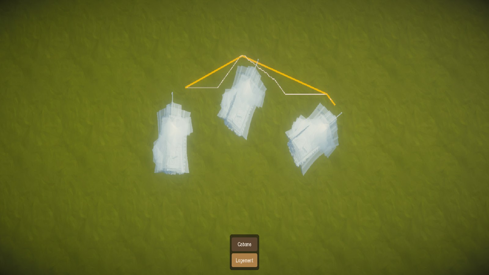
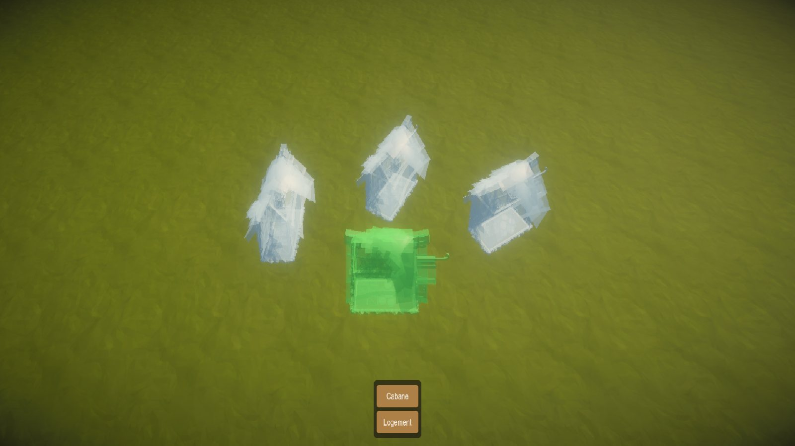
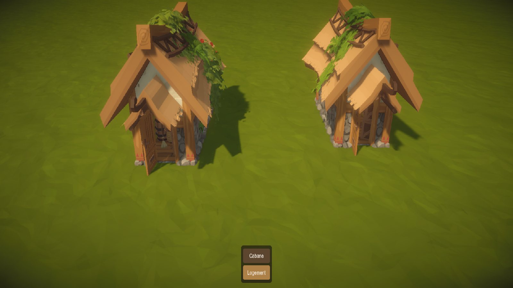
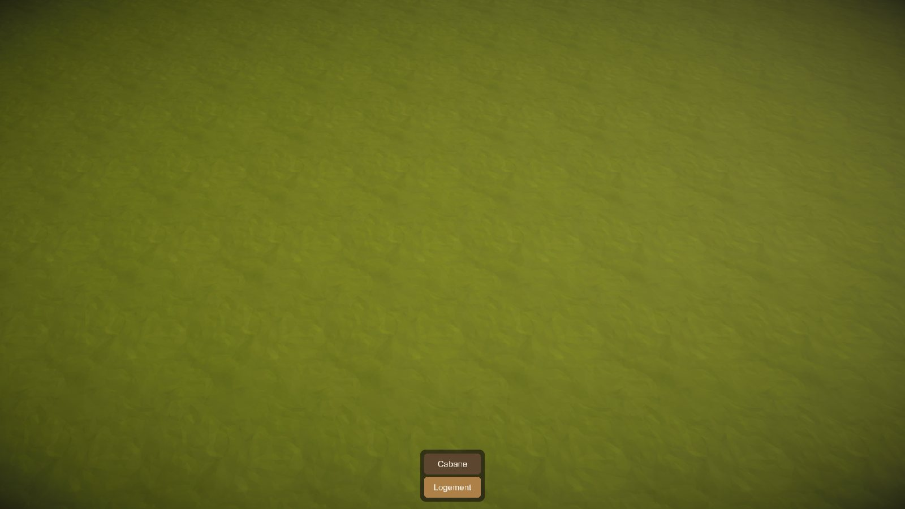
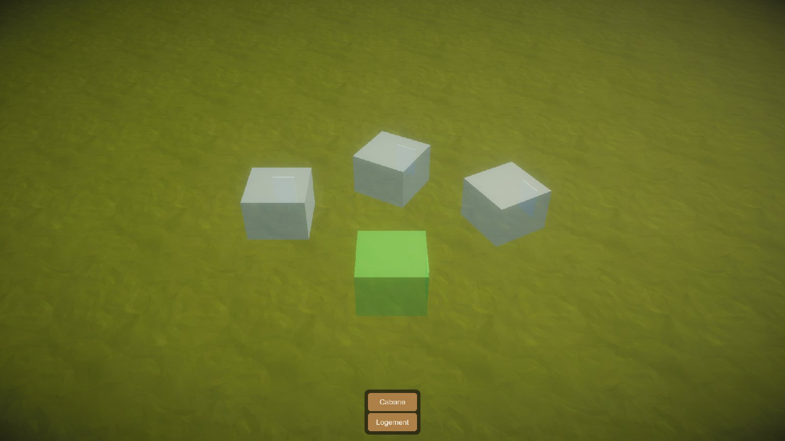
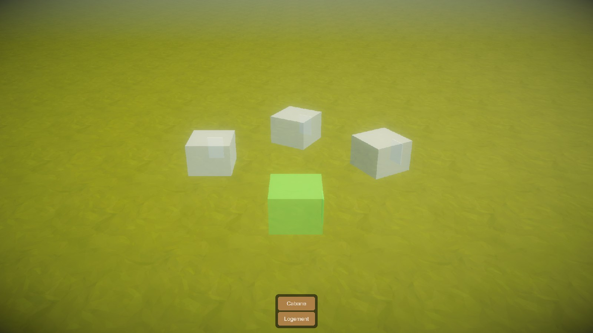
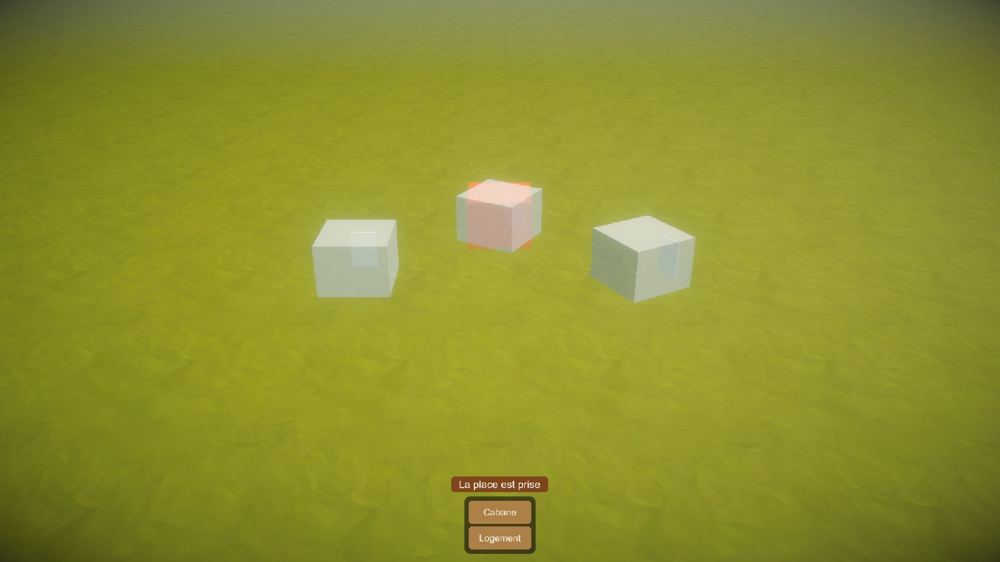
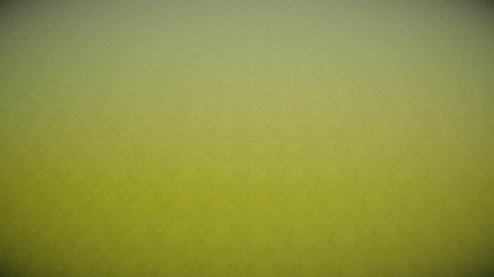

# DICIELA — l'album

> L'évolution du jeu en captures, la plus récente en haut. Avec `DECISIONS.md`, c'est le seul document qui garde son
> histoire.

**Comment on le tient**

- **Quand** : à chaque étape qui change ce qu'on voit, pendant le Play court de la procédure `verifier` ; en cours
  d'étape aussi, dès qu'un changement visible le mérite. Souvent plutôt que rarement.
- **Quoi** : la vue témoin (toujours le même point de vue, pour comparer d'une étape à l'autre), puis une vue de ce qui
  est nouveau.
- **Où** : `Docs/Album/AAAA-MM-JJ_etape-N_sujet.jpg`, en JPG (le PNG pèse trop lourd dans Git).
- **Ensuite** : Claude regarde chaque capture une fois, pour vérifier qu'elle montre bien la chose ; il ajoute l'entrée
  ci-dessous (date, étape, une ligne sur ce qui a changé, les images) et envoie les captures au développeur.

## Les captures

### 28/09/2026 — étape 9b : l'injoignable su tout de suite, le trajet tendu

Rien ne change pour le joueur : 9b travaille dans la simulation, et la vue témoin reste celle de l'entrée d'en
dessous. La planche des trajets le montre, vue de dessus : les trois cabanes de la mise en scène de l'album, en
fantôme, et le trajet d'un piéton de la porte de la première (à gauche, porte au nord) à celle de la dernière (à
droite, tournée de 60°, porte vers l'est). En blanc, l'escalier de mailles que trouve la recherche ; en orange, la
ligne tendue qu'on en tire : elle passe au nord de la cabane du milieu en pliant contre son coin, plie une dernière
fois pour contourner la cabane de droite et finit devant sa porte. Escalier de 28,2 m, ligne tendue de 26,2 m,
cherchés et tendus en 9 ms sur la carte de 500 m.

### 28/09/2026 — étape 8c : la cabane a son modèle

La cabane prend `Bld_Preset_Shed_02` du pack, préparé une fois par un menu : ses 62 pièces fusionnées en un seul
maillage (15 matériaux), tourné porte au nord, centré, la porte au niveau du sol et les fondations enfoncées. Son
empreinte passe de la boîte de 4 × 4 m à 5,99 × 8,47 m, accessoires compris. D'abord la même mise en scène que les deux
entrées d'en dessous : trois cabanes posées en fantôme, tournées de 0°, 30° et 60°, et l'aperçu vert de la suivante ;
un fantôme ne montre que la silhouette. Puis la planche des modèles, vue du côté des portes : à gauche le modèle
préparé, à droite celui du pack, tel quel ; la préparation ne change pas l'art (on les voit sous deux angles).

### 27/09/2026 — ménage 4 : la revue, un seul soleil et la nouvelle caméra

La vue témoin, reprise : la caméra part plus près (57 m, à mi-chemin des crans de molette), un peu moins inclinée, et
la carte n'est plus éclairée que par le soleil du pack. La scène de jeu gardait la lumière par défaut d'Unity, qui
doublait la sienne : l'herbe est plus sombre et son relief ressort. La pose de l'étape 8b, sous ce seul soleil, à
comparer avec l'entrée d'en dessous. Les ombres suivent désormais le zoom ; elles se verront avec les premiers
modèles, les fantômes n'en font pas.

### 27/09/2026 — étape 8b : poser une cabane

La pose devient visible, depuis la vue de départ rapprochée du centre. En bas, la barre de construction : la famille
« Logement » et sa « Cabane ». Trois cabanes posées attendent leurs bâtisseurs en fantômes translucides, tournées
de 0°, 30° et 60° : ce sont des boîtes à leur taille, porte marquée, en attendant leur modèle. L'aperçu de la
suivante est vert sur une place libre ; sur une place prise, il est rouge et la raison s'écrit au-dessus de la barre.
Les deux vues sont mises en scène par les menus `DICIELA/Album/…`, qui tiennent l'outil de pose à la place de la
souris.

### 27/09/2026 — étapes 6 et 7 : la carte vierge, vue par la caméra de gestion

La vue de départ de la caméra (le centre de la carte, à mi-distance, face au nord), qui sert de vue témoin tant que la
vue témoin de l'architecture n'existe pas. La carte n'est pas encore peinte : l'herbe du pack sur 500 m, avec sa
lumière, son brouillard et ses filtres (le vignetage sur les bords).

