

  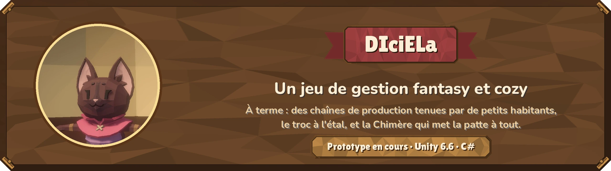

> 🇫🇷 The French version comes first: [README.md](README.md). This page is its English translation. The banners and the
> game's interface are in French.

DIciELa is a cozy fantasy production-chain game, still a prototype (Unity 6.6, C#).

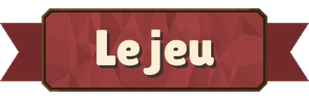

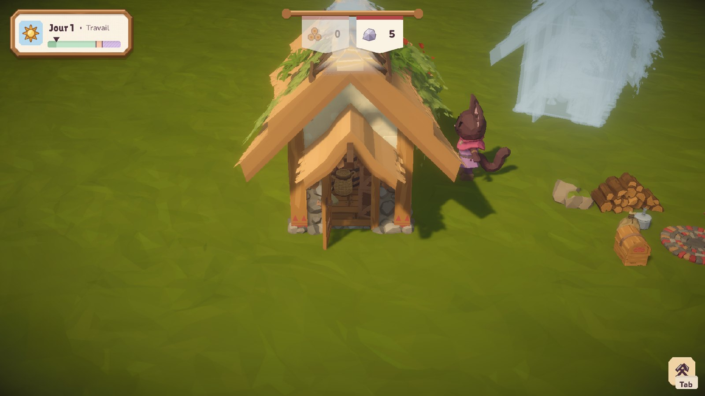

It all starts with a clearing, a pile of wood, a little stone, and the Chimera. You set up the camp, and the Chimera takes
up its post there: it carries the wood and the stone, and the huts go up plank by plank. Then the first villagers arrive,
each with a trade. Eventually they will progress by working and run the production chains, while you barter at the stall and
decorate the town to your taste.

Today, the **first day is playable**: creating the Chimera, the camp, the building sites, the paths, and the **foresight**
(V key), which shows the town as it will be once its building sites are finished. A roguelike run will come later. The whole
evolution, step by step, is in [the album](Docs/ALBUM.md) (in French).

| The Chimera, in the workshop | A hut going up | The first villagers |
| :---: | :---: | :---: |
| 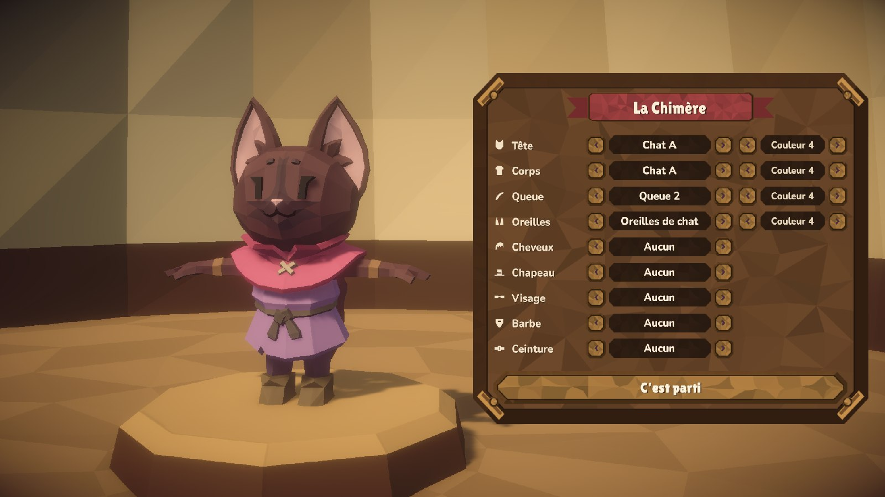 | 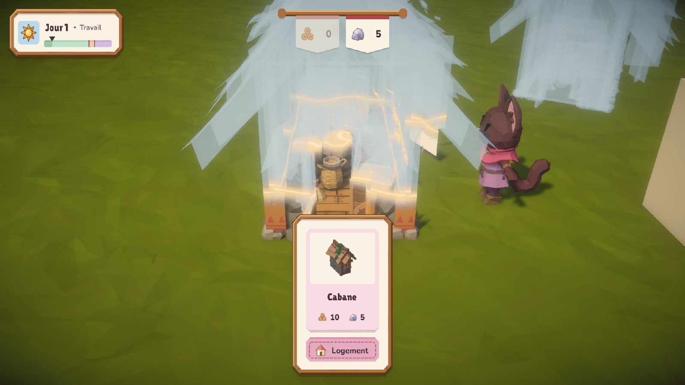 | 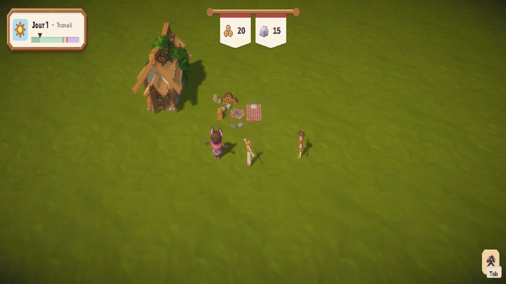 |

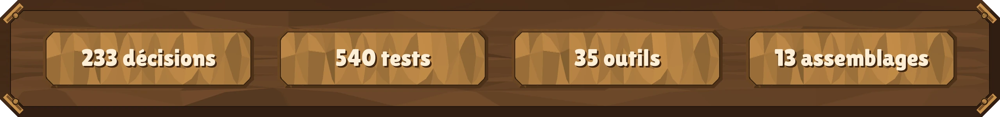

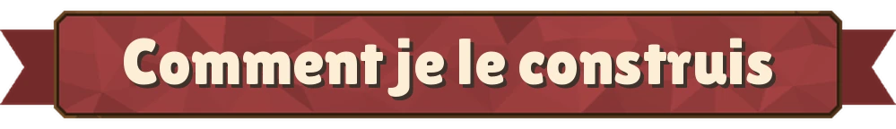

DIciELa is my game: the design ([`GDD.md`](Docs/GDD.md)), the decisions and the in-game trials. The C# is written by Claude
Code: I am new to Unity and C#, and I learn by having it explained. I design, I make the calls (often on its
recommendations, and that is written in the decisions) and I check in the game. To keep control of the project from one
session to the next, it works within a framework that I set up. That framework is in the repository, to be read like the
rest (in French):

- 📜 **Short rules.** [`CLAUDE.md`](CLAUDE.md) fits in under 200 lines. The rules for C#, data, tests and documents live in
  [`.claude/rules/`](.claude/rules) and only load when those files are touched.
- 🧰 **Procedures written once** ([`.claude/skills/`](.claude/skills)): driving the Unity editor from the command line,
  checking before every commit (recompile, EditMode then PlayMode tests, a short Play, the console read again), closing a
  session, knowing the art pack.
- 🛡️ **A guard rail.** A hook run before every command ([`garde-unity.js`](.claude/hooks/garde-unity.js)) refuses anything
  that would freeze the editor or damage the game in progress, such as a `git checkout` that would reload an open scene.
- 🧠 **A memory outside the conversation.** Every session starts with [`ETAT.md`](Docs/ETAT.md), thirty lines that say where
  the working repository stands. Every choice is numbered, dated and justified in [`DECISIONS.md`](Docs/DECISIONS.md), and
  the known pitfalls are in [`SAVOIR.md`](Docs/SAVOIR.md). When a game rule is missing, the assistant asks for it instead of
  guessing.
- 🪜 **One step at a time.** One branch per step, a commit that never leaves without the tests, and screenshots in the album
  as soon as something changes on screen.
- 🔁 **Starting over when it is needed.** A first prototype piled up two versions of everything. I stopped it: this version
  starts from a fresh project (decision 1), with what it taught me recorded in `SAVOIR.md`.

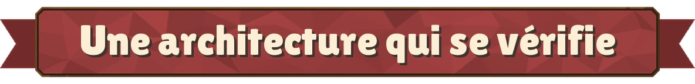

The simulation is **C# with no MonoBehaviour and no scene**, on a fixed time step, unaware that it is being drawn: it raises
events, and the view listens to them. It is split into assemblies, and a test compares the `.asmdef` files with the rules
copied from the table in [`ARCHITECTURE.md`](Docs/ARCHITECTURE.md): one reference too many or one moved folder, and it fails.

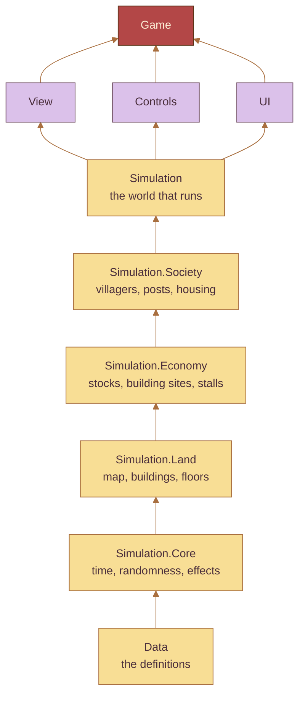

In butter, the simulation; in lavender, what shows it and controls it; in brick, the start-up that assembles everything. An
arrow goes from an assembly to those allowed to read it (the diagram is simplified).

- ✅ **540 tests** at the last run (288 EditMode, 252 PlayMode). A test goes through the player's path: the same call as the
  gesture in the game.
- 🗂️ **All content is data**: ScriptableObjects, and no hard-coded text (everything is in `strings.csv`). The last interface
  settings still written in the code are recorded as a debt, in `ETAT.md`.
- ✂️ **No C# file over 200 lines.** A file that grows is split within the step.

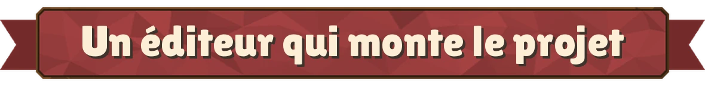

Nothing is assembled by hand: what is scripted can be redone and versioned. The editor's `DICIELA` menu has **35 tools**.
Nine serve the project: they assemble the scenes, complete the data definitions and the keyboard actions, prepare and
compose the models from the pack, generate the interface images and the creation workshop, photograph the buildings for
their thumbnails, and start a game. The other twenty-six take the album's screenshots, always from the same point of view,
to compare one step with the next.

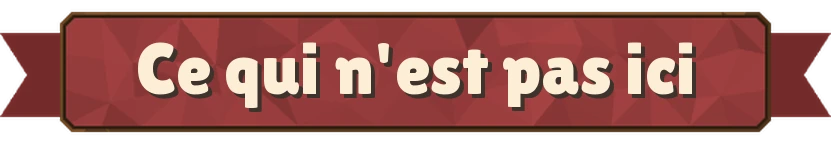

The art comes from the **POLYGON Fantasy Village** pack by Synty Studios, bought under licence. No model, mesh, texture or
animation from the pack is published, nor anything derived from it: the cut-out characters, the merged models, the interface
frame, the building thumbnails and the album boards that showed its pieces outside the game. They have been removed from the
whole history of this repository, and the editor tools rebuild them from the pack. What remains is the game's screenshots and
three settings files taken from the pack's demo scene, without any of its objects: the map (a blank relief and a light), its
earth layer and its filter profile. So you need the pack to see the game. This repository is a copy of my working
repository, updated from time to time.

### Running it at home

1. **Unity `6000.6.0f1`** exactly (the version in `ProjectSettings/ProjectVersion.txt`), with the Unity CLI:
   `unity install 6000.6.0f1`, or the Unity Hub.
2. **The tests, without the pack**: `unity test . --mode EditMode`. Tests that read the pack or anything derived from it are
   skipped, not failed: they run in the working repository, where the pack is imported.
3. **The game, with the pack**: buy POLYGON Fantasy Village on the Asset Store and import it, without moving anything, into
   `Assets/Synty/` (the folder is ignored by Git). Then, in the editor's `DICIELA` menu: `Contenu/Préparer les modèles`,
   `Contenu/Composer les modèles`, `Interface/Générer les images de l'interface`,
   `Interface/Photographier les constructions`, `Interface/Générer l'atelier`, `Scènes/Monter les scènes`, and finally
   `DICIELA/Jouer` (or the scene `Assets/Scenes/Jeu.unity`).
4. **The Claude Code framework**: the guard rail calls the CLI through `UNITY_CLI` if it is set, otherwise at its install
   location (`%LOCALAPPDATA%\Unity\bin`), otherwise through the PATH; `node Tools/garde-unity.test.js` replays its cases.

© 2026 Mateo Sanchez, all rights reserved: the code is public to be read, not to be reused without my
agreement. The art pack remains the property of Synty Studios. The Lilita One and Nunito fonts are under the SIL Open Font
License, with their licences in <code>Assets/UI/Polices</code>. The banners and plaques on this page are made from the game's
interface elements by <code>Tools/vitrine_images.py</code>; the other images are screenshots of the game.

