

  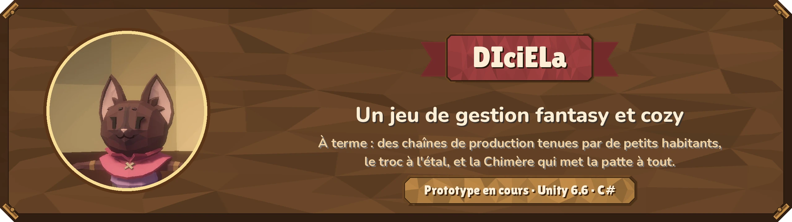

> **In English.** DIciELa is a cozy fantasy production‑chain game, still a prototype (Unity 6.6, C#). The plan: little
> villagers with jobs run your production chains, you barter at the market stall, and the Chimera, our mascot, lends a
> paw everywhere. Today, the first day is playable: creating the Chimera, the camp, building sites, paths, and a preview
> of the finished town. This repository also shows how it is built: a C# simulation with no MonoBehaviour, whose
> boundaries are enforced by tests, editor tools that build the project, and the framework I set up for Claude Code,
> which writes the C#. The code is in English, the docs in French.

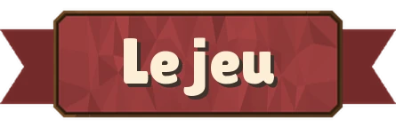

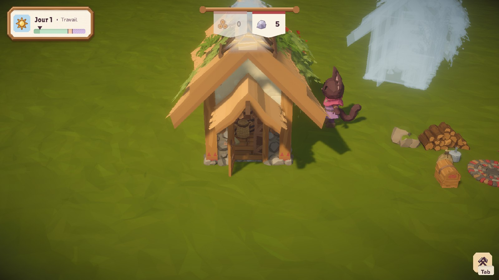

Tout commence par une clairière, un tas de bois, un peu de pierre, et la Chimère. On installe le campement, la Chimère y
prend son poste : elle porte le bois et la pierre, et les cabanes montent planche par planche. Puis arrivent les premiers
habitants, chacun avec son métier. À terme, ils progresseront en travaillant et tiendront les chaînes de production,
pendant que vous troquerez à l'étal et décorerez la ville à votre goût.

Aujourd'hui, la **première journée se joue** : la création de la Chimère, le campement, les chantiers, les chemins, et la
**prévision** (touche V), qui montre la ville telle qu'elle sera une fois ses chantiers finis. Une run roguelike viendra
après. Toute l'évolution, étape par étape, est dans [l'album](Docs/ALBUM.md).

| La Chimère, dans l'atelier | Une cabane qui monte | Les premiers habitants |
| :---: | :---: | :---: |
| 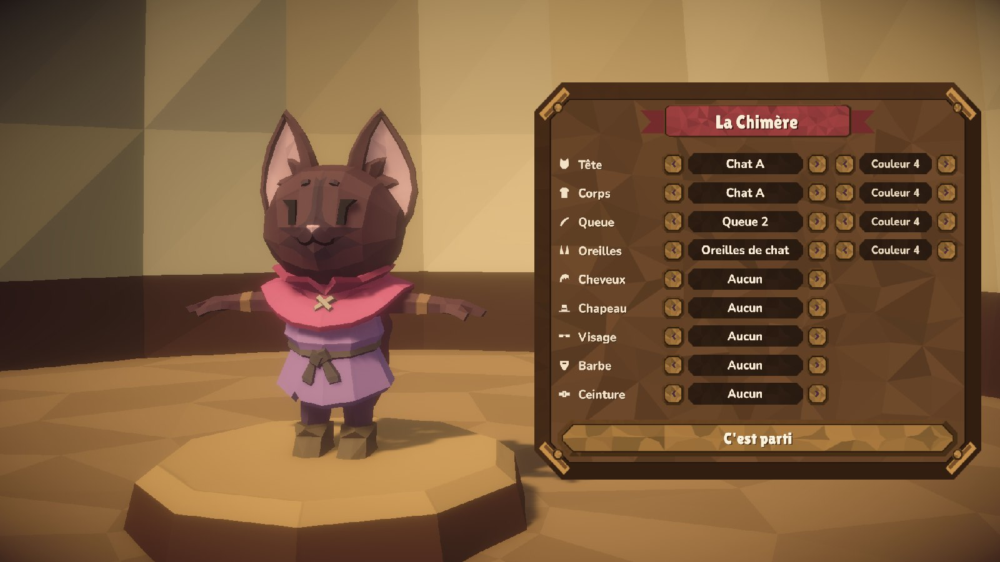 | 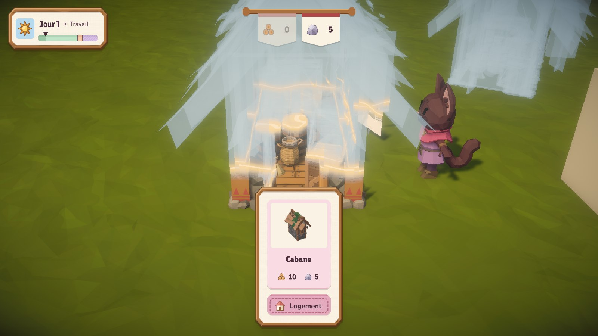 | 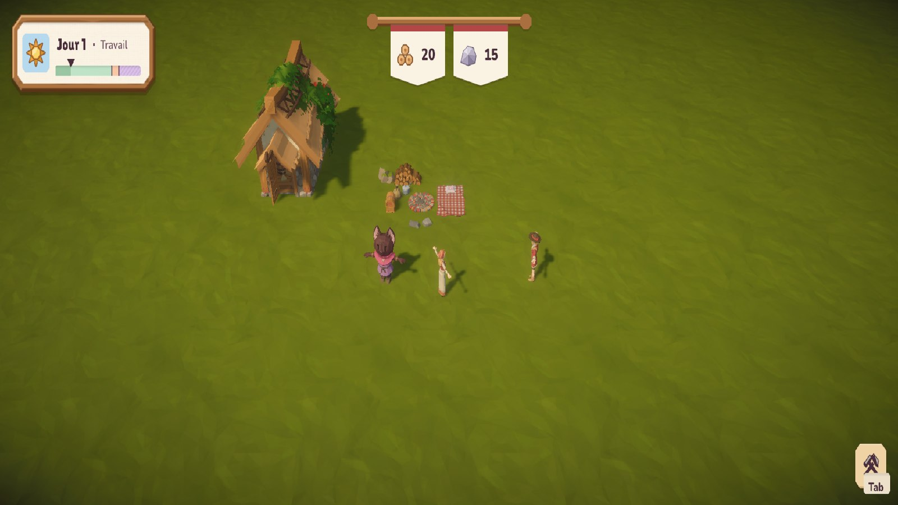 |

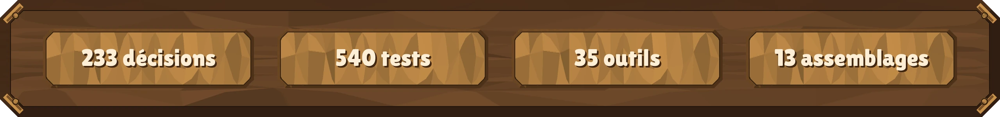

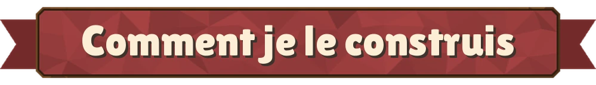

DIciELa, c'est mon jeu : le design ([`GDD.md`](Docs/GDD.md)), les décisions et les essais en jeu. Le C# est écrit par
Claude Code : je débute en Unity et en C#, et j'apprends en le faisant expliquer. Moi, je conçois, je tranche (souvent sur
ses recommandations, et c'est écrit dans les décisions) et je vérifie en jeu. Pour garder la main sur le projet d'une
session à l'autre, il travaille dans un cadre que j'ai posé. Ce cadre est dans le dépôt, à lire comme le reste :

- 📜 **Des règles courtes.** [`CLAUDE.md`](CLAUDE.md) tient en moins de 200 lignes. Les règles du C#, des données, des tests
  et des documents vivent dans [`.claude/rules/`](.claude/rules) et ne se chargent que quand on touche ces fichiers.
- 🧰 **Des procédures écrites une fois** ([`.claude/skills/`](.claude/skills)) : piloter l'éditeur Unity en ligne de
  commande, vérifier avant chaque commit (recompiler, tests EditMode puis PlayMode, un Play court, la console relue),
  clore une session, connaître le pack d'art.
- 🛡️ **Un garde-fou.** Un hook lancé avant chaque commande ([`garde-unity.js`](.claude/hooks/garde-unity.js)) refuse ce qui
  figerait l'éditeur ou abîmerait la partie en cours, comme un `git checkout` qui rechargerait une scène ouverte.
- 🧠 **Une mémoire hors de la conversation.** Chaque session commence par [`ETAT.md`](Docs/ETAT.md), trente lignes qui disent
  où en est le dépôt de travail. Chaque choix est numéroté, daté et justifié dans [`DECISIONS.md`](Docs/DECISIONS.md), et
  les pièges connus sont dans [`SAVOIR.md`](Docs/SAVOIR.md). Une règle de jeu qui manque, l'assistant la demande au lieu de la deviner.
- 🪜 **Une étape à la fois.** Une branche par étape, un commit qui ne part jamais sans les tests, et des captures dans
  l'album dès que quelque chose change à l'écran.
- 🔁 **Repartir de zéro quand il le faut.** Un premier prototype empilait deux versions de chaque chose. Je l'ai arrêté :
  cette version repart d'un projet neuf (décision 1), avec ce qu'il m'a appris noté dans `SAVOIR.md`.

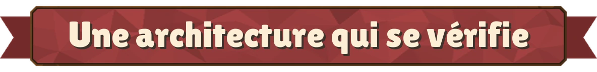

La simulation est du **C# sans MonoBehaviour ni scène**, à pas fixe, qui ne sait pas qu'elle est dessinée : elle lève des
événements, la vue les écoute. Elle est découpée en assemblages, et un test compare les `.asmdef` aux règles recopiées du
tableau d'[`ARCHITECTURE.md`](Docs/ARCHITECTURE.md) : une référence de trop ou un dossier déplacé, et il échoue.

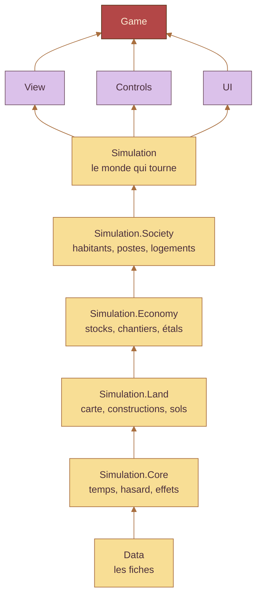

En beurre, la simulation ; en lavande, ce qui la montre et la commande ; en brique, le démarrage qui assemble le tout. Une
flèche va d'un assemblage vers ceux qui ont le droit de le lire (le schéma est simplifié).

- ✅ **540 tests** au dernier passage (288 EditMode, 252 PlayMode). Un test passe par le chemin du joueur : le même appel que
  le geste en jeu.
- 🗂️ **Tout le contenu est donnée** : des ScriptableObjects, et aucun texte en dur (tout est dans `strings.csv`). Les
  derniers réglages d'interface écrits dans le code sont notés comme une dette, dans `ETAT.md`.
- ✂️ **Aucun fichier C# de plus de 200 lignes.** Un fichier qui grossit est découpé dans l'étape.

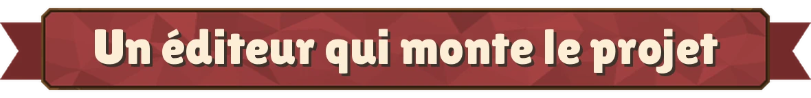

Rien ne se monte à la main : ce qui est scripté se refait et se versionne. Le menu `DICIELA` de l'éditeur compte
**35 outils**. Neuf servent le projet : ils montent les scènes, complètent les fiches de données et les actions du
clavier, préparent et composent les modèles à partir du pack, génèrent les images de l'interface et l'atelier de création,
photographient les constructions pour leurs vignettes, et lancent une partie. Les vingt-six autres prennent les captures de
l'album, toujours du même point de vue, pour comparer d'une étape à l'autre.

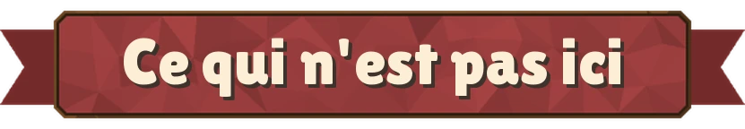

L'art vient du pack **POLYGON Fantasy Village** de Synty Studios, acheté sous licence. Aucun modèle, maillage, texture ni
animation du pack n'est publié, ni ce qu'on en tire : les personnages découpés, les modèles fusionnés, le cadre de
l'interface, les vignettes des constructions et les planches de l'album qui montraient ses pièces hors du jeu. Ils sont
retirés de tout l'historique de ce dépôt, et les outils de l'éditeur les refont à partir du pack. Restent les captures du jeu
et trois fichiers de réglages repris de la scène de démonstration du pack, sans aucun de ses objets : la carte (un relief
vierge et une lumière), son calque de terre et son profil de filtres. Il faut donc le pack pour voir le jeu. Ce dépôt est une
copie de mon dépôt de travail, mise à jour de temps en temps.

© 2026 Mateo Sanchez, tous droits réservés : le code est public pour être lu, pas pour être réutilisé
sans mon accord. Le pack d'art reste la propriété de Synty Studios. Les polices Lilita One et Nunito sont sous licence SIL
Open Font, avec leurs licences dans <code>Assets/UI/Polices</code>. Les bandeaux et les plaques de cette page sont faits
des éléments d'interface du jeu par <code>Tools/vitrine_images.py</code> ; les autres images sont des captures du jeu.

