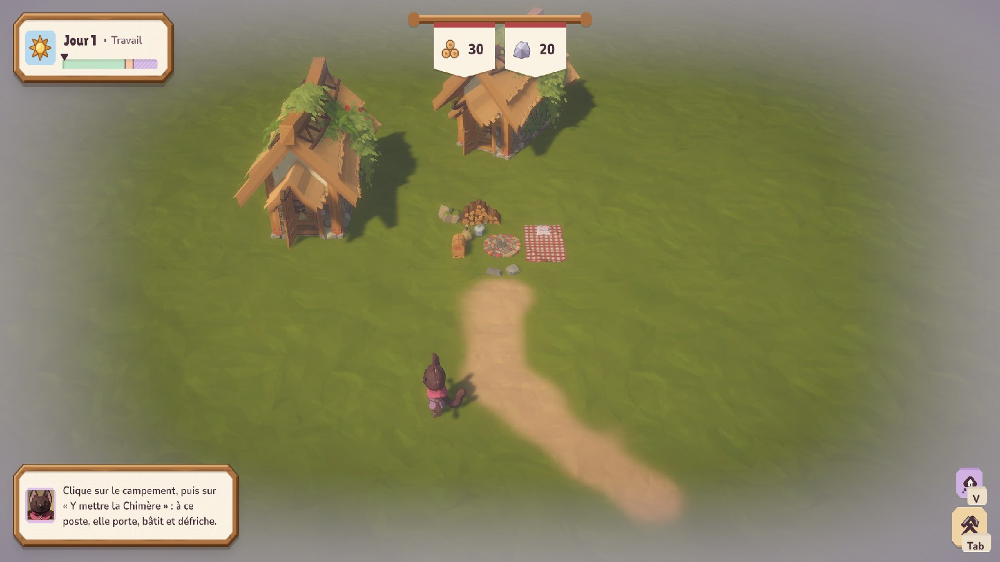
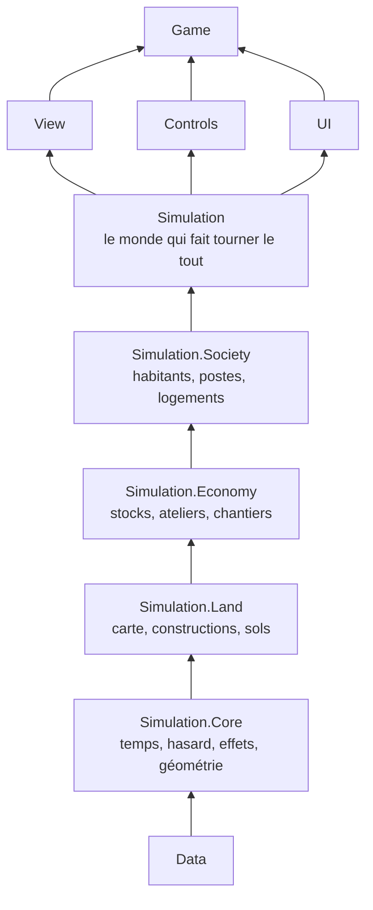

# DIciELa

**Prototype en cours** · Unity 6.6 (URP) · C#

Un « Satisfactory » fantasy et cozy : on bâtit des chaînes de production tenues par de petits habitants qui ont un métier et
progressent en travaillant, on troque à l'étal, on décore en pose libre, et la Chimère, la mascotte, met la main à tout.

> **In English.** DIciELa is a cozy fantasy production‑chain game, still a prototype (Unity 6.6, C#). What this repository
> shows is how it is built: an AI‑assisted workflow with Claude Code (path‑scoped rules, skills, a safety hook, 233 numbered
> decisions), a pure C# simulation split into 13 assemblies whose boundaries are enforced by tests (540 tests), and 35 editor
> tools that build scenes, data and art. Code and docs are in French. The purchased art pack is not included.

| La Chimère, dans l'atelier de création | Un chantier qui monte |
| --- | --- |
|  |  |

## Où en est le jeu

La première journée se joue : on crée la Chimère, on installe le campement, on pose des cabanes que les habitants bâtissent en
portant le bois et la pierre, on trace des chemins, et la prévision (touche V) montre la ville une fois ses chantiers finis.
Une run roguelike viendra après le prototype de la simulation. L'évolution du jeu, étape par étape, est dans
[l'album](Docs/ALBUM.md).

## Comment je le construis avec Claude Code

Le C# est écrit par Claude Code. Mon travail, c'est de concevoir le jeu, de trancher, de vérifier en jeu, et de tenir le cadre
qui garde le projet cohérent d'une session à l'autre. Ce cadre est dans le dépôt :

- **Des instructions courtes, et des règles par dossier.** [`CLAUDE.md`](CLAUDE.md) tient en moins de 200 lignes. Les règles
  du C#, des données, des tests et des documents sont dans [`.claude/rules/`](.claude/rules) et ne se chargent que quand on
  touche ces fichiers.
- **Des procédures écrites une fois** ([`.claude/skills/`](.claude/skills)) : piloter l'éditeur Unity en ligne de commande, la
  passe de vérification avant chaque commit (recompiler, tests EditMode puis PlayMode, un Play court, la console relue), la fin
  de session, et ce qu'il faut savoir du pack d'art.
- **Un garde-fou.** Un hook lancé avant chaque commande ([`.claude/hooks/garde-unity.js`](.claude/hooks/garde-unity.js))
  refuse les gestes qui figeraient l'éditeur ou abîmeraient la partie en cours, comme un `git checkout` qui rechargerait une
  scène ouverte.
- **Une mémoire hors de la conversation.** Chaque session commence par [`Docs/ETAT.md`](Docs/ETAT.md), trente lignes qui disent
  où on en est. Les choix de design et d'architecture sont numérotés, datés et justifiés dans
  [`Docs/DECISIONS.md`](Docs/DECISIONS.md) (233 à ce jour) ; les pièges connus sont dans [`Docs/SAVOIR.md`](Docs/SAVOIR.md).
  Une règle de jeu qui manque, Claude la demande au lieu de la deviner.
- **Une étape à la fois.** Une branche par étape, un commit qui ne part jamais sans que les tests aient tourné, et des captures
  dans l'album à chaque changement visible.
- **Repartir de zéro quand il le faut.** Un premier prototype empilait deux versions de chaque chose. Je l'ai arrêté : cette
  version repart d'un projet neuf (décision 1), avec ce qu'il m'a appris écrit dans `SAVOIR.md`.

## Une architecture vérifiée par les tests

La simulation est du C# pur, à pas fixe, qui ne sait pas qu'elle est dessinée : elle lève des événements, la vue les écoute.
Elle est découpée en assemblages ; une flèche va d'un assemblage vers ceux qui ont le droit de le lire (le schéma est
simplifié, le tableau complet est dans [`Docs/ARCHITECTURE.md`](Docs/ARCHITECTURE.md)). Un test compare les `.asmdef` à ce
tableau : une référence de trop ou un dossier déplacé le fait échouer.

- **540 tests** au dernier passage (288 EditMode, 252 PlayMode). Un test passe par le chemin du joueur : le même appel que le
  geste en jeu.
- **Tout le contenu est donnée** : des ScriptableObjects, aucun nombre magique, aucun texte en dur (tout est dans
  `Assets/Localization/strings.csv`).
- **Aucun fichier de plus de 200 lignes.** Un fichier qui grossit est découpé dans l'étape.

## Un éditeur qui monte le projet

Rien ne se monte à la main : ce qui est scripté se refait et se versionne. Le menu `DICIELA` de l'éditeur compte 35 outils :
monter les scènes, créer les fiches de données qui manquent, préparer et composer les modèles à partir du pack, générer les
images de l'interface et l'atelier de création, photographier les constructions pour leurs vignettes, et prendre les captures
de l'album toujours du même point de vue, pour comparer d'une étape à l'autre.

## Ce qui n'est pas dans ce dépôt

L'art vient du pack POLYGON Fantasy Village de Synty Studios, acheté sous licence. Ni le pack ni les fichiers tirés de lui
(personnages découpés, modèles fusionnés, cadre de l'interface) ne sont publiés : les outils de l'éditeur les refont à partir
du pack. Il faut donc le pack pour voir le jeu. Ce dépôt est une copie de mon dépôt de travail, sans ces fichiers, mise à jour
de temps en temps.

## Droits

© 2026 Mateo Sanchez, tous droits réservés. Le code est public pour être lu, pas pour être réutilisé sans mon accord. Le pack
d'art reste la propriété de Synty Studios. Les polices Lilita One et Nunito sont sous licence SIL Open Font, avec leurs
licences dans `Assets/UI/Polices`.
