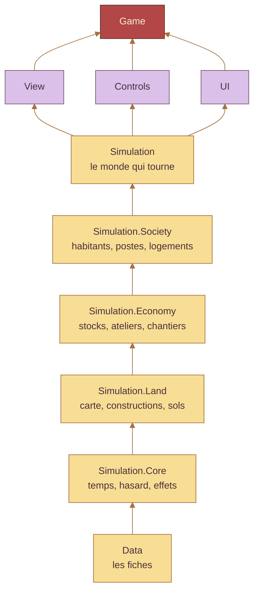

  

> **In English.** DIciELa is a cozy fantasy production‑chain game, still a prototype (Unity 6.6, C#). Little villagers
> with real jobs run your production chains, you barter at the market stall, and the Chimera, our mascot, lends a paw
> everywhere. This repository is also a showcase of how it is built: an AI‑assisted workflow with Claude Code, a pure C#
> simulation whose boundaries are enforced by tests, and editor tools that build the project. Code and docs are in French.

Tout commence par une clairière, un tas de bois, un peu de pierre, et la Chimère. On installe le campement, la Chimère y
prend son poste : elle porte le bois et la pierre, et les cabanes montent planche par planche. Puis arrivent les premiers habitants : chacun a un métier, et
progresse en travaillant. À terme, ce sont eux qui tiennent les chaînes de production, pendant que vous troquez à l'étal et
décorez la ville à votre goût.

Aujourd'hui, la **première journée se joue** : la création de la Chimère, le campement, les chantiers, les chemins, et la
**prévision** (touche V), qui montre la ville telle qu'elle sera une fois ses chantiers finis. Une run roguelike viendra
après. Toute l'évolution, étape par étape, est dans [l'album](Docs/ALBUM.md).

| La Chimère, dans l'atelier | Une cabane qui monte | Les premiers habitants |
| :---: | :---: | :---: |
|  |  |  |

Le C# est écrit par **Claude Code**. Moi, je conçois le jeu, je tranche, je vérifie en jeu, et surtout je tiens le cadre
qui garde le projet cohérent d'une session à l'autre. Ce cadre est dans le dépôt, à lire comme le reste :

- 📜 **Des règles courtes.** [`CLAUDE.md`](CLAUDE.md) tient en moins de 200 lignes. Les règles du C#, des données, des tests
  et des documents vivent dans [`.claude/rules/`](.claude/rules) et ne se chargent que quand on touche ces fichiers.
- 🧰 **Des procédures écrites une fois** ([`.claude/skills/`](.claude/skills)) : piloter l'éditeur Unity en ligne de
  commande, vérifier avant chaque commit (recompiler, tests EditMode puis PlayMode, un Play court, la console relue),
  clore une session, connaître le pack d'art.
- 🛡️ **Un garde-fou.** Un hook lancé avant chaque commande ([`garde-unity.js`](.claude/hooks/garde-unity.js)) refuse ce qui
  figerait l'éditeur ou abîmerait la partie en cours, comme un `git checkout` qui rechargerait une scène ouverte.
- 🧠 **Une mémoire hors de la conversation.** Chaque session commence par [`ETAT.md`](Docs/ETAT.md), trente lignes qui disent
  où on en est. Chaque choix est numéroté, daté et justifié dans [`DECISIONS.md`](Docs/DECISIONS.md), et les pièges connus
  sont dans [`SAVOIR.md`](Docs/SAVOIR.md). Une règle de jeu qui manque, Claude me la demande au lieu de la deviner.
- 🪜 **Une étape à la fois.** Une branche par étape, un commit qui ne part jamais sans les tests, et des captures dans
  l'album dès que quelque chose change à l'écran.
- 🔁 **Repartir de zéro quand il le faut.** Un premier prototype empilait deux versions de chaque chose. Je l'ai arrêté :
  cette version repart d'un projet neuf (décision 1), avec ce qu'il m'a appris noté dans `SAVOIR.md`.

La simulation est du **C# pur**, à pas fixe, qui ne sait pas qu'elle est dessinée : elle lève des événements, la vue les
écoute. Elle est découpée en assemblages, et un test compare les `.asmdef` au tableau de
[`ARCHITECTURE.md`](Docs/ARCHITECTURE.md) : une référence de trop ou un dossier déplacé, et il échoue.

En beurre, la simulation ; en lavande, ce qui la montre et la commande ; en brique, le démarrage qui assemble le tout. Une
flèche va d'un assemblage vers ceux qui ont le droit de le lire (le schéma est simplifié).

- ✅ **540 tests** au dernier passage (288 EditMode, 252 PlayMode). Un test passe par le chemin du joueur : le même appel que
  le geste en jeu.
- 🗂️ **Tout le contenu est donnée** : des ScriptableObjects, aucun nombre magique, aucun texte en dur (tout est dans
  `strings.csv`).
- ✂️ **Aucun fichier de plus de 200 lignes.** Un fichier qui grossit est découpé dans l'étape.

Rien ne se monte à la main : ce qui est scripté se refait et se versionne. Le menu `DICIELA` de l'éditeur compte
**35 outils**. Ils montent les scènes, créent les fiches de données qui manquent, préparent et composent les modèles à partir
du pack, et génèrent les images de l'interface et l'atelier de création. Ils photographient aussi les constructions pour
leurs vignettes, et prennent les captures de l'album toujours du même point de vue, pour comparer d'une étape à l'autre.

L'art vient du pack **POLYGON Fantasy Village** de Synty Studios, acheté sous licence. Ni le pack ni les fichiers tirés de
lui (personnages découpés, modèles fusionnés, cadre de l'interface) ne sont publiés : les outils de l'éditeur les refont à
partir du pack. Il faut donc le pack pour voir le jeu. Ce dépôt est une copie de mon dépôt de travail, sans ces fichiers,
mise à jour de temps en temps.

© 2026 Mateo Sanchez, tous droits réservés : le code est public pour être lu, pas pour être réutilisé
sans mon accord. Le pack d'art reste la propriété de Synty Studios. Les polices Lilita One et Nunito sont sous licence SIL
Open Font, avec leurs licences dans <code>Assets/UI/Polices</code>. Les images de cette page sont faites des éléments
d'interface du jeu par <code>Tools/vitrine_images.py</code>.

